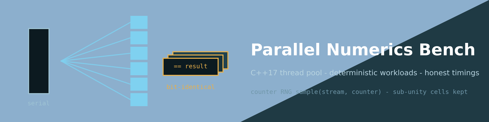
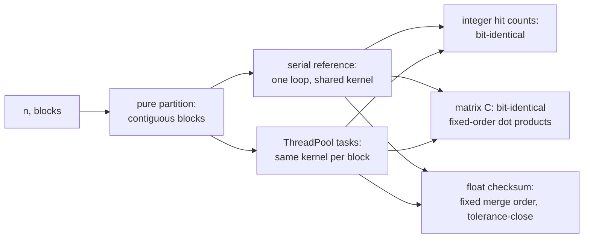
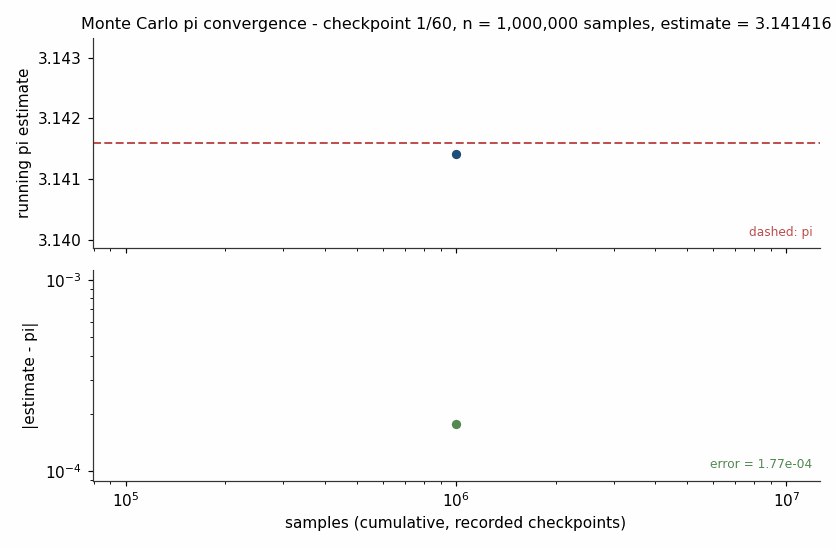

<div align="center">



# ⚙️ Parallel Numerics Bench

### Deterministic serial/parallel accuracy & honest scaling

**An original C++17 thread pool with deterministic workloads, equivalence tests and
honest multi-repeat timings — answers that do not drift when you add threads, and
speedup tables that keep the bad cells.**

[](https://github.com/khalil-official/parallel-numerics-bench/actions/workflows/ci.yml)
[](LICENSE)
[](src)
[](tests)
[](docs/results/speedup_table.md)
[](https://github.com/khalil-official/parallel-numerics-bench/stargazers)

[Quick start](#-quick-start) · [Determinism contract](#-determinism-contract) · [Animation](#%EF%B8%8F-results-gallery) · [Measured results](#-measured-results-this-machine-this-run) · [References](#-references-by-title)

</div>

---

## 🎯 Purpose and scope

Parallel numerical code has two failure modes that benchmarks usually hide:
**answers that drift when you add threads**, and **speedup tables that cherry-pick
the good cells**. This project is a small, complete, from-scratch answer to both:

| Piece | What it is |
| --- | --- |
| 🧵 **`ThreadPool`** | header-only (condition-variable worker queue, `enqueue` → `std::future`), ~100 lines, no dependencies beyond the C++17 standard library |
| 🎲 **MC pi workload** | counter-based RNG — samples addressed by `(stream, counter)`, split by stream so serial and parallel use the **identical sample set** |
| 🔢 **Matrix product** | blockwise dense product with one shared kernel |
| ✅ **Serial references** | machine-checked equivalence: exactly what is bit-identical, what is only tolerance-close, and why |
| ⏱️ **Measurement driver** | written methodology: ≥ 7 repeats per cell (8 kept + 1 discarded cold run), median and min, interleaved serial/parallel rounds, full scatter, sub-unity speedups reported as-is |

> **Scope limits up front:** shared memory only (no MPI/GPU/distributed), no NUMA
> or affinity claims, timings are machine-specific (hardware string in every
> results file), and the RNG is statistical — not cryptographic, not
> BigCrush-certified ([docs/verification.md](docs/verification.md)).

## 🧵 Determinism contract

The unit of work is a contiguous block; the partitioning is a pure function of
(n, blocks); **ONE shared kernel** computes a block, called once by the serial
reference and once per task by the parallel path, so scheduling cannot change any
bit. MC hit counts are integers — exact, associative, bit-identical under ANY
partitioning. Every matrix element is a fixed-order dot product — C is
bit-identical under any row-block partitioning. The floating checksum is merged
from block partials and is deliberately claimed only tolerance-close (measured
≤ 7.3e-15 relative, bit-identical at 1 thread) because floating addition is not
associative — but its merge order is fixed, so it is still bit-stable across
reruns. Full version in [docs/model.md](docs/model.md).



## ⚡ Quick start

```bash
cmake -S . -B build -DCMAKE_BUILD_TYPE=Release   # GCC/Clang/MSVC, C++17
cmake --build build
ctest --test-dir build --output-on-failure       # 9 test executables
./build/pnb_bench --mode smoke                   # tiny end-to-end sanity run
```

Reproduce the measurements (CSVs land in `docs/results/`):

```bash
./build/pnb_bench --mode scaling      # timed sweep, bench.csv
./build/pnb_bench --mode equivalence  # serial vs parallel sweep, equivalence.csv
./build/pnb_bench --mode progress     # 60-checkpoint MC run, progress.csv

pip install -r scripts/requirements.txt   # matplotlib + pillow (plotting only)
python scripts/plot_results.py --cpu "your CPU here"   # figures + tables + summary
python scripts/make_gif.py                             # animation from progress.csv
```

The workloads are pure C++; Python touches only the recorded CSVs. Warning
policy: `-Wall -Wextra -Wpedantic` (`/W4` on MSVC), CI builds with `-Werror`.

<details>
<summary><b>🧱 Architecture</b></summary>

```
src/thread_pool.hpp    ThreadPool: workers + condition_variable + task queue;
                       enqueue -> std::future (values and exceptions)
src/counter_rng.hpp    counter-based RNG: sample(stream, counter) = mixed64 of
                       both; stream splitting; raw-counter negative control
src/workloads.hpp      partitioning helpers, shared block kernels, serial and
                       parallel variants of both workloads + input validation
src/timing.hpp         Stopwatch (steady_clock), median/min statistics
src/bench_main.cpp     measurement driver: scaling / equivalence / progress /
                       smoke modes, CSV + environment recording
tests/                 9 CTest executables (pool, RNG statistics, partition,
                       equivalence x2, determinism, validation, timing, headers)
scripts/               plot_results.py, make_gif.py (consume CSVs only)
docs/                  model.md (math + methodology), api.md,
                       verification.md (evidence + limits), results/
```

</details>

## ✅ Verification summary

- **9/9 CTest suites pass**: pool semantics (futures, exception propagation,
  drain-on-destroy, exact task counts), RNG statistics (determinism, chi-square
  equidistribution, pairwise stream correlation, lag-1 autocorrelation of a merged
  interleaved stream, overlapping-window test, plus a raw-counter negative control
  that must FAIL), partition invariants, serial/parallel equivalence for both
  workloads across sizes and thread counts, cross-run determinism, input
  validation, timing statistics.
- In-run determinism: every repeat of every bench cell produced an identical
  result string (`run_summary.json` flag:
  `bench_results_bit_stable_across_repeats: true`).
- CI: Ubuntu + Windows matrix, CMake build + CTest + smoke run
  ([.github/workflows/ci.yml](.github/workflows/ci.yml)).

Per-test evidence and the exact limits of every claim:
[docs/verification.md](docs/verification.md).

## ⚠️ Limitations

Shared-memory single-machine parallelism only; no NUMA/affinity/pinning claims;
timings are specific to one laptop and one session (record your own with the
commands above); the RNG is a statistical generator whose tested properties are
exactly those listed in [docs/model.md](docs/model.md) — nothing more is claimed;
the matrix kernel is a reference kernel (no blocking/SIMD tuning), so absolute
matmul times are not a FLOPS claim.

---

## 🎞️ Results gallery

<div align="center">

**▶ Watch Monte Carlo pi converge (recorded serial run):**



<sub>Animation provenance: generated by <code>scripts/make_gif.py</code> from
<code>docs/results/progress.csv</code>, recorded on 2026-10-18 by
<code>pnb_bench --mode progress</code> (serial run, 60 checkpoints × 1,000,000
fresh counter-RNG samples each, 60,000,000 samples total) on the Intel i5-12500H
described below. Each of the 60 frames is one recorded checkpoint at its actual
sample count — nothing interpolated or synthesized. Final recorded estimate:
3.14166.</sub>

</div>

### 📈 Measured results (this machine, this run)

Full table: [docs/results/speedup_table.md](docs/results/speedup_table.md) ·
scatter of every repeat: [docs/results/scaling.png](docs/results/scaling.png) ·
machine record: [docs/results/run_summary.json](docs/results/run_summary.json).

Context: Intel i5-12500H (12 cores: 8P+4E, 16 logical), Windows 11, GCC 16.2.0
Release, medians of 8 kept repeats (cold run discarded, serial/parallel cells
interleaved round by round).

| Workload | Size | Serial median | 16-thread median | Speedup | Honest note |
|---|---|---|---|---|---|
| Monte Carlo pi | 5,000,000 | 93.8 ms | 10.0 ms | **9.36x** | near-linear to 8 P-cores, then hyper-threads |
| Matrix product | 768 | 1.506 s | 0.237 s | **6.35x** | compute-bound naive kernel |
| Monte Carlo pi | 100,000 | 1.66 ms | 0.33 ms | 5.08x | small size still scales, but see the 1-worker row |
| Monte Carlo pi | 100,000 (1 worker) | 1.66 ms | 2.11 ms | **0.79x** | pool dispatch SLOWER than serial at ~ms scale — reported as measured |
| Matrix product | 96 (1 worker) | 1.12 ms | 1.32 ms | **0.85x** | same overhead story, reported as measured |

Also read in the table: threads=1 cells at larger sizes show up to ~1.1x
"speedup" over serial — both paths run the identical kernel, so that is CPU
frequency-state drift between interleaved cells on this power-limited laptop, not
a parallel effect; speedups should be read from threads ≥ 2.

Equivalence (24 recorded cells, `docs/results/equivalence.csv`): MC hit counts
and matrix C **bit-identical in every cell**; parallel reruns bit-stable in every
cell; checksum relative deltas 0 (1 thread) to 7.3e-15 (16 threads) — the
documented non-associativity, plotted in
[docs/results/equivalence_deltas.png](docs/results/equivalence_deltas.png).

## 🔑 License

MIT — see [LICENSE](LICENSE). Copyright (c) 2026 MOHAMMED AHMED.

## 📚 References (by title)

- *C++ Concurrency in Action* (Anthony Williams) — the condition-variable thread
  pool and packaged_task/future patterns this project implements from scratch.
- *The Art of Computer Programming, Vol. 2: Seminumerical Algorithms* (Donald E.
  Knuth) — chi-square equidistribution testing and the theory behind
  counter/mixing constructions.
- *Random Number Generation and Monte Carlo Methods* (James E. Gentle) — stream
  splitting and parallel RNG design.
- *What Every Computer Scientist Should Know About Floating-Point Arithmetic*
  (David Goldberg) — non-associativity of floating addition, the reason the
  checksum claim is tolerance-level only.
